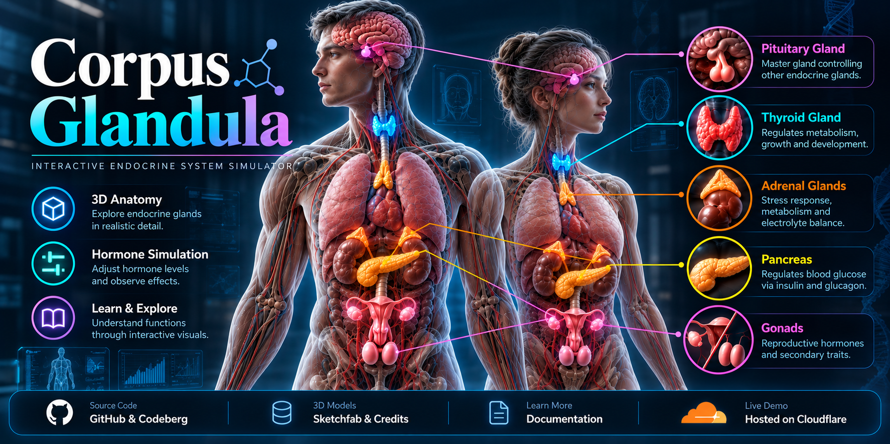

  

<h1 align="center">🧬 Corpus Glandula</h1><h3 align="center"><em>Interactive Endocrine System Simulator</em></h3>An interactive 3D visualization of the human endocrine system, exploring hormone regulation and physiological responses.

  <a href="https://cor-gl.stark-kodex.workers.dev"><strong>Explore the Simulation </strong></a>

---

✨ Features

- 🧍 3D Anatomy — Explore and rotate the realistic human body model.
- 🧪 Hormone Simulations — Investigate hormonal activity and physiological responses.
- 🔬 Scientific Visualization — Explore endocrine structures and processes.
- 📱 Responsive Design — Supports desktop and mobile devices.

---

🧬 **Core Concepts**

Endocrine Glands · Hormones · Homeostasis · Hormonal Regulation · Physiological Responses

---

🧑🏻‍💻 **Technology**

🔸HTML · CSS · JavaScript
🔸Asset Delivery:GitHub Repo
🔸Repository: GitHub & Codeberg
🔸Hosting: Cloudflare

---

📜 **License**

Distributed under the "GNU GPL-3.0 License" (LICENSE).
